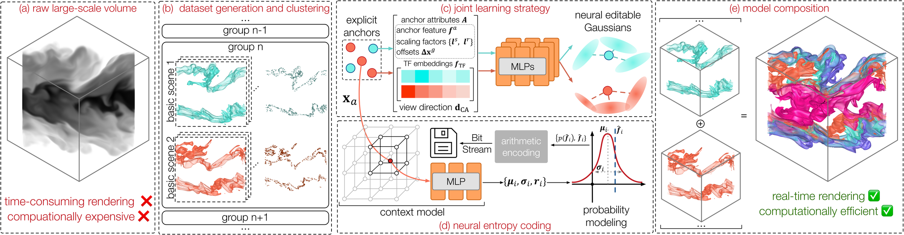

# ECoNGS: Efficient Compressive Neural Gaussian Splats for Volume Visualization



## Description
This is the official implementation for **ECoNGS: Efficient Compressive Neural Gaussian Splats for Volume Visualization**.

ECoNGS is an efficient compressive neural Gaussian splatting framework for volume visualization (VolVis) scene representation. It uses lightweight neural networks to dynamically predict implicit, editable Gaussian splats from explicit anchor points, combining the compactness and parameter efficiency of implicit representations with the high-performance rendering of explicit primitives. ECoNGS further (1) shares parameters across geometrically similar scenes through a joint learning strategy to reduce training time and model size, and (2) compresses the explicit anchor attributes with a neural entropy model that estimates their probability distributions for compact storage through entropy coding.

## Setup

```bash
git clone https://github.com/TouKaienn/ECoNGS.git
conda create --name econgs python=3.9
conda activate econgs

#* install python dependencies
cd ECoNGS
pip install -r requirements.txt

#* install the CUDA extensions (diff_gauss / fused_ssim / gridencoder / simple_knn / arithmetic)
cd submodules
bash install_all.sh
cd ..
```

ECoNGS uses the MPEG **G-PCC / TMC13** codec to compress Gaussian geometry, invoked at run
time through the `tmc3` binary. Build it separately and add it to `PATH`:

```bash
git clone https://github.com/MPEGGroup/mpeg-pcc-tmc13
cd mpeg-pcc-tmc13 && mkdir build && cd build && cmake .. && make -j
export PATH="$PATH:$(pwd)/tmc3"      # the `tmc3` binary must be discoverable on PATH
```

## Dataset structure
We organize the datasets like this:

```
.
└── combustion
    ├── TF01
    │   ├── test
    │   ├── train
    │   ├── transforms_test.json
    │   └── transforms_train.json
    ├── TF02
    ├── TF03
    ...
```
where ``combustion`` is the volume dataset name, ``TF01`` is the first sampled transfer
function (TF), ``train`` and ``test`` are the folders holding the training and testing
images, and the ``.json`` files store the camera poses.

## Training and Evaluation
Train ECoNGS on a multi-TF dataset (joint learning + entropy compression):
```bash
bash script/train.sh <dataset_root> "TF01,TF02,TF03" <exp_name> <lambda>
```
``<dataset_root>`` is the volume dataset folder shown above, ``<lambda>`` controls the
rate-distortion trade-off, and the trained model is written to ``../Exp/<exp_name>/...``.

After training, render all views and evaluate from the trained model:
```bash
bash script/render.sh <view_path> <model_dir> <output_dir> "TF01 TF02 TF03"
```

You can also use our GUI to compose multiple TF models and edit color, opacity, and lighting:
```bash
bash script/gui.sh <model_dir>
```

## Acknowledgement
A special thanks to the open-source community, especially the following amazing projects:
- [3D Gaussian Splatting](https://github.com/graphdeco-inria/gaussian-splatting)
- [Scaffold-GS](https://github.com/city-super/Scaffold-GS)
- [HAC](https://github.com/YihangChen-ee/HAC)
- [iVR-GS](https://github.com/TouKaienn/iVR-GS)
- [DearPyGui](https://github.com/hoffstadt/DearPyGui)
- [MPEG-PCC-TMC13](https://github.com/MPEGGroup/mpeg-pcc-tmc13)
